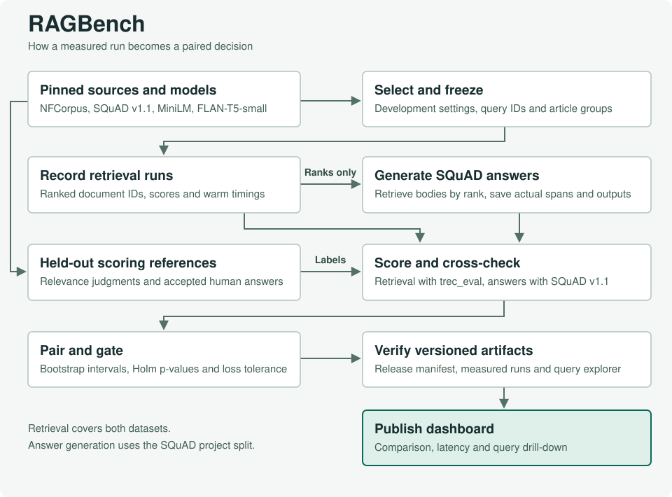

# RAGBench

RAGBench answers a practical question about a retrieval change. **On the same queries, which scores moved, how uncertain is the difference, and did the candidate stay within the allowed loss?** A Python runner scores your rankings or answer strings. The experiment notebook lets you trace each recorded comparison down to document ranks, generated answers and the text the model actually received.

[RAGForge](https://github.com/Sashankpotluru/RAGForge) is a separate application for searching documents and answering from sources. RAGBench evaluates frozen runs. It contributes evaluation software, a reproducible experiment and inspectable evidence. It makes no new-algorithm or overall state-of-the-art claim.

[Open the experiment notebook](https://sashankpotluru.github.io/RAGBench/) · [Inspect the queries](https://sashankpotluru.github.io/RAGBench/#queries) · [Download the release overview](results/release.json)

## What happened when the generator received passages?

The same FLAN-T5-small checkpoint answered 200 SQuAD questions under three configurations. The hybrid top-three configuration gained **62.87 percentage points of token F1** over closed-book. Its pairwise 95% interval was **+54.97 to +69.86 points**, with Holm-adjusted p = 0.00020 across two primary comparisons. The candidate won on 146 questions, tied on 48 and lost on six. [Paired answer estimates](results/comparisons/squad-v1.1-answers.json)

| Input to FLAN-T5-small | Exact match (%) | Token F1 (%) | Warm generation p50 / p95 (ms) | Gold paragraph supplied |
| --- | ---: | ---: | ---: | ---: |
| Question only | 0.00 | 4.32 | 30.75 / 55.42 | 0 / 200 |
| Tuned BM25, request 1 passage | 55.00 | 64.72 | 41.27 / 81.67 | 149 / 200 |
| Tuned hybrid, request 3 passages | 57.00 | 67.19 | 51.57 / 85.62 | 169 / 200 |

All 600 generated responses are recorded. Timings measure a warm, batch-one model generation call on one Apple M4 Pro CPU, after prompt construction and before text decoding. Retrieval has its own measured boundary. The number of passages that fit depends on the token budget. [Predictions](results/answers/predictions) · [Runtime](results/answers/runtime.json) · [Independent SQuAD score check](results/answers/crosscheck.json)

The smaller contrast between hybrid top three and BM25 top one was **+2.47 F1 points**, with an exploratory pairwise interval of **−1.84 to +6.47** and p = 0.26607 in a family of one. Both a small loss and a gain are compatible with these data. The configurations differ in retrieval method **and** requested passage count, so their comparison cannot isolate the effect of fusion. [Pair estimates and comparison families](results/comparisons/squad-v1.1-answers.json)

## Did retrieval improve on both datasets?

The answer depends on the corpus and the comparison. All four systems used the same queries and graded relevance judgments within each dataset. Scores below are mean nDCG@10 on its 0–1 scale. [Run configurations and scores](results/release.json)

| Dataset | Fixed BM25 | Tuned BM25 | MiniLM | Tuned hybrid |
| --- | ---: | ---: | ---: | ---: |
| NFCorpus official test, 323 queries | 0.3064 | 0.3018 | 0.3167 | 0.3283 |
| SQuAD project evaluation, 200 queries | 0.8272 | 0.8368 | 0.7275 | 0.8389 |

- On **NFCorpus**, hybrid gained 2.19 nDCG points over fixed BM25. Its pairwise interval was +0.14 to +4.22 points. The Holm-adjusted p was 0.10169 across three primary comparisons, above 0.05 despite the positive pairwise interval. [NFCorpus comparisons](results/comparisons/nfcorpus-beir-retrieval.json)
- On **SQuAD**, MiniLM lost 9.97 points against fixed BM25. The pairwise interval of −14.74 to −5.06 points fell entirely below the two-point loss limit, a regression (Holm p = 0.00270). Hybrid gained 1.17 points against fixed BM25, with an interval of −1.35 to +3.55 and Holm p = 0.36356. [SQuAD retrieval comparisons](results/comparisons/squad-v1.1-retrieval.json)

## What was measured?

| Collection | Development | Evaluation | Searchable collection | Tasks |
| --- | ---: | ---: | ---: | --- |
| BEIR NFCorpus | All 324 official dev queries | All 323 official test queries | 3,633 documents | Retrieval |
| SQuAD v1.1 public validation | 50 questions | 200 questions across 36 observed articles | All 2,067 validation paragraphs | Retrieval and generated answers |

NFCorpus is a graded relevance collection. SQuAD uses deterministic question selection from article-disjoint project pools, with evaluation split ID `project-hash-v1-eval200`. FLAN-T5 may have encountered SQuAD-related material in training. The public validation sample supports conclusions about these measured runs. [NFCorpus authors](https://www.cl.uni-heidelberg.de/statnlpgroup/nfcorpus/) · [BEIR distribution](https://huggingface.co/datasets/BeIR/nfcorpus) · [SQuAD authors](https://rajpurkar.github.io/SQuAD-explorer/) · [Selection protocol](docs/protocol.md)

The runner freezes development-selected BM25 and weighted reciprocal-rank fusion settings before evaluation. It compares these with fixed BM25 and a pinned MiniLM encoder. Retrieval scoring covers linear-gain nDCG@10, Recall@5/10/100, MRR@10 and Precision@10. Independent trec_eval-based checks cover development choices and held-out scores. Answer scoring takes the best normalized exact match and token F1 across the human aliases, checked against the upstream SQuAD scorer. [MiniLM model](https://huggingface.co/sentence-transformers/all-MiniLM-L6-v2) · [FLAN-T5-small model](https://huggingface.co/google/flan-t5-small) · [trec_eval](https://github.com/usnistgov/trec_eval) · [Pinned answer scorer](benchmarks/vendor/squad/source.json)



[Editable Mermaid source](docs/architecture.mmd) · [Full measurement and timing protocol](docs/protocol.md)

## Score your own run

Start from a checkout with Python 3.12 or 3.13. The installed `ragbench` CLI scores and compares saved files without model downloads.

```sh
python -m venv .venv
. .venv/bin/activate
python -m pip install -e .
```

For example, score the released tuned BM25 rankings on NFCorpus. Replace the TREC path with your own rankings to evaluate another candidate against the same judgments. JSON query-to-document score maps are also accepted.

```sh
ragbench score --qrels results/retrieval/nfcorpus-beir/eval-qrels.json \
  --run results/retrieval/nfcorpus-beir/runs/bm25-tuned.trec \
  --dataset-id nfcorpus-beir --split-id official-test --output candidate.json
ragbench compare results/retrieval/nfcorpus-beir/evaluations/bm25-fixed.json \
  candidate.json --metric 'ndcg@10' --margin .02 --output comparison.json
```

For answers, supply a JSON map of query ID to output string, accepted reference strings per ID and the article map for clustered inference. These two tiny examples illustrate the interchange format.

```sh
printf '%s\n' '{"q1":["Oslo"],"q2":["Lima"]}' > references.json
printf '%s\n' '{"q1":"Oslo","q2":"Quito"}' > predictions.json
printf '%s\n' '{"q1":"article-a","q2":"article-b"}' > articles.json
ragbench answers --references references.json --predictions predictions.json \
  --groups articles.json --dataset-id example --split-id local --output answers.json
```

The comparator aligns query IDs and verifies the dataset, split, references, scoring version and groups. Missing predictions score zero. Unexpected IDs, duplicates and nonfinite scores fail validation. A single CLI comparison forms a family of one. The released experiment declares its comparison families before Holm adjustment. [CLI input and statistical contract](docs/evaluation-contract.md)

## Use a regression gate

Each candidate-minus-baseline interval uses 10,000 paired percentile bootstrap draws, seed 20261119. The resampling unit is the query for NFCorpus and the article for SQuAD. Each sampled article contributes all its questions. Two-sided paired sign flips use the same unit, with Holm correction within each declared family. The intervals cover individual pairs. [Comparison implementation](src/ragbench/compare.py) · [Protocol](docs/evaluation-contract.md)

With a margin of 0.02 on the 0–1 score scale, the CLI returns the following statuses. The dashboard expresses the same margin as **2 percentage points** and reclassifies the recorded bounds when you change it.

| Status | Exit | Decision |
| --- | ---: | --- |
| Within tolerance | 0 | Lower bound ≥ −0.02. The evidence supports the stated allowed loss. |
| Regression | 1 | Upper bound < −0.02. |
| Inconclusive | 2 | The interval includes values on both sides of the decision boundary, or ends exactly at the boundary from below. |
| Invalid evidence | 3 | Input or output validation failed. |

The declared release gate compares hybrid top three to closed-book on SQuAD token F1. A pass answers the tolerance question. A claim of superiority needs its own statistical interpretation. [Recorded gate](results/release.json) · [Gate tests](tests/test_cli.py)

## Verify or reproduce

To reconstruct the public release from its recorded inputs, use the source checkout with lightweight replay dependencies. This verifies the file inventory, frozen selections, rankings, actual prompts, token IDs, scores, comparisons and explorer rows before applying the declared gate.

```sh
python -m pip install -e . pytrec-eval-terrier==0.5.11 tokenizers==0.23.3
python -m benchmarks.verify --gate
python scripts/build_site.py
python -m http.server 8000 --directory site
```

Read the notebook at the local server root. The build copies only verified evidence and named public assets. Its `site-manifest.json` lists byte counts and SHA-256 values for each payload file. The manifest itself is excluded from that inventory. [Site builder](scripts/build_site.py) · [Release verifier](benchmarks/verify.py)

For a new measurement, use the benchmark dependency lock from the original Python 3.13 macOS arm64 environment and provide a **new** output directory in the checkout. The script downloads pinned datasets and model snapshots, checks their hashes, runs retrieval and generation, and assembles a separate verified release. Replicating recorded timings requires comparable hardware and settings.

```sh
python -m pip install -r requirements-benchmark.txt -e .
sh scripts/reproduce.sh --results reproduced
python -m benchmarks.verify --results reproduced --gate
```

The historical one-argument form, `sh scripts/reproduce.sh new-retrieval-directory`, runs retrieval and its cross-check only. Benchmark scripts run from the checkout. The wheel supplies the evaluation CLI. [Runner](scripts/reproduce.sh) · [Model and data digests](benchmarks/sources.json) · [Runtime and source commit](results/answers/runtime.json)

The first release's answer input binding was reconstructed **after inference** against the pinned SQuAD source and the original committed evidence. Its 600 predictions and timings are preserved. Future runs bind inputs before loading the model. Offline replay reconstructs 725 actual supplied excerpts from 483 archived candidate paragraphs and verifies exact prompts and decoded outputs. Hashes identify content. They cannot establish publisher identity, authenticate a timing, or measure semantic faithfulness. A matching reference string in a supplied excerpt is a literal-text diagnostic. [Input binding](results/answers/input-binding.json) · [Replay details](docs/protocol.md#measurement-input-binding)

## Development and licenses

```sh
python -m pip install -r requirements-dev.txt pytrec-eval-terrier==0.5.11 tokenizers==0.23.3
python -m pytest -q
ruff check .
mypy
node --test web/tests/*.test.mjs
```

CI runs on Python 3.12 and 3.13 with Node 22 web tests, an isolated wheel smoke test, a regression fixture and release replay. Pages deploys after checks and a verified build. [CI](.github/workflows/ci.yml) · [Pages](.github/workflows/pages.yml)

Original code is MIT. Adapted SQuAD text retains CC BY-SA 4.0 attribution to Rajpurkar et al. Published NFCorpus evidence contains identifiers and measurements only. The model artifacts, serialized tokenizer and upstream scorer retain their respective terms. [MIT license](LICENSE) · [Third-party sources and notices](THIRD_PARTY_NOTICES.md)
